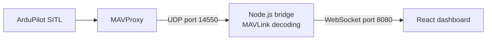

# Browser Ground Control Station (GCS)

A web-based Ground Control Station for monitoring an ArduPilot drone simulation, prepared for a technical trial submission to TraceX.

## Overview and Features

This project provides a real-time, browser-based dashboard to visualize telemetry data from an ArduPilot drone.

**Features:**
- Receives live MAVLink telemetry from an ArduPilot SITL (Software In The Loop) simulation.
- Decodes `GLOBAL_POSITION_INT`, `SYS_STATUS`, `HEARTBEAT`, and `ATTITUDE` messages.
- Broadcasts telemetry efficiently over WebSockets.
- Displays a professional, dark-themed React dashboard featuring:
  - Flight Mode and connection status.
  - Altitude (MSL) and Relative Altitude.
  - Ground Speed.
  - Battery Remaining (percentage and voltage).
  - Position (Latitude, Longitude).
  - Attitude (Roll, Pitch, Yaw).

## Technologies Used

- **Simulation**: ArduPilot SITL, MAVProxy
- **Backend (Bridge)**: Node.js, `mavlink-2`, `ws` (WebSocket)
- **Frontend (Dashboard)**: React 18, Vite, standard CSS

## Architecture



## Prerequisites and Setup (WSL2 Ubuntu Context)

*Note: These instructions assume you are running ArduPilot SITL in a WSL2 Ubuntu environment or similar Linux setup.*

1. **Node.js**: Ensure Node.js (v18+) is installed.
2. **ArduPilot SITL & MAVProxy**: Must be installed and configured in your WSL2/Linux environment.

## Startup Instructions

To run the full stack, you need to open four separate terminal windows/tabs. The SITL, MAVProxy, Node.js backend, and React frontend must all run simultaneously in their own terminals.

### 1. Start the ArduPilot Simulation
In a WSL2 Ubuntu terminal, navigate to your ArduPilot directory and start the SITL instance:
```bash
cd ~/ardupilot/ArduCopter
source ~/venv-ardupilot/bin/activate
../build/sitl/bin/arducopter --model + --speedup 1 --slave 0 --sim-address=127.0.0.1 -I0
```

### 2. Start MAVProxy and Forward Telemetry
In a **second** WSL2 Ubuntu terminal, activate the same Python virtual environment, connect to the running SITL instance, and add the UDP output for the backend:
```bash
source ~/venv-ardupilot/bin/activate
mavproxy.py --master=tcp:127.0.0.1:5760
```
Once the MAVProxy prompt appears, add the UDP output:
```text
output add 127.0.0.1:14550
```

### 3. Start the Backend Bridge
In a **third (WSL2 Ubuntu)** terminal, navigate to the project directory:
```bash
cd /mnt/c/Users/User/Documents/Backup/gcs-project

# Install backend dependencies (if not already done)
npm install

# Start the Node.js MAVLink bridge
npm start
```
*(Alternatively, from Windows PowerShell, you can run: `wsl --cd /mnt/c/Users/User/Documents/Backup/gcs-project npm start`)*

> [!IMPORTANT]
> Because ArduPilot SITL and MAVProxy send UDP packets to `127.0.0.1:14550` inside WSL2, the bridge **must** run inside WSL2 to receive those UDP packets. In WSL2 architecture, `127.0.0.1` is the VM's internal loopback; WSL2 does not forward UDP packets sent to `127.0.0.1` across the virtual machine boundary to Windows.

You should see:
```text
WebSocket server running on ws://localhost:8080
UDP bridge listening on 127.0.0.1:14550
Waiting for drone telemetry...
MAVLink receiver definitions loaded
MAVLink sender ready (System ID: 255, Component ID: 190)
```
*(Followed by periodic telemetry updates and packet diagnostic counters).*


### 4. Start the React Frontend
In a **fourth** terminal, navigate to the `client/` directory within this project:
```bash
cd client

# Install frontend dependencies (if not already done)
npm install

# Start the Vite development server
npm run dev
```
The application will be available at `http://localhost:5173`.

## Telemetry Fields and Data Flow

The `bridge.js` script decodes the following MAVLink messages into a JSON state object:
- **`GLOBAL_POSITION_INT`**: Latitude, Longitude, Altitude, Relative Altitude, Ground Speed.
- **`SYS_STATUS`**: Battery Voltage, Battery Remaining.
- **`HEARTBEAT`**: Flight Mode (e.g., STABILIZE, GUIDED, AUTO).
- **`ATTITUDE`**: Roll, Pitch, Yaw (converted from radians to degrees).

This state is broadcast to connected WebSocket clients every 2 seconds. The React dashboard subscribes to this data and updates its components accordingly. When no data is available, the UI gracefully displays `--`.

## Troubleshooting and Limitations

- **No Telemetry Data**: Check if `bridge.js` output indicates MAVLink packets are being received. Ensure MAVProxy is outputting to `127.0.0.1:14550` and not blocked by a firewall (especially common with WSL2 network bridges).
- **Connection Refused on Dashboard**: Ensure `bridge.js` is running and the WebSocket server is successfully bound to port `8080`.
- **Limitations**: Currently, this is a read-only telemetry dashboard. It does not send commands (e.g., arm, takeoff, change modes) back to the drone.

## Future Improvements
- Implement bidirectional communication to allow sending commands to the drone.
- Add a 2D map component (e.g., Leaflet or Mapbox) to display the drone's position visually.
- Plot telemetry metrics over time using charting libraries.
