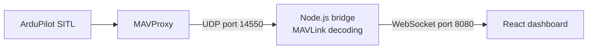

# Browser Ground Control Station (GCS)

A browser ground control station for ArduPilot multicopter telemetry, with an offline 3D simulator and flight replay.

## Overview and Features

This project provides a real-time, browser-based dashboard to visualize telemetry data from an ArduPilot drone.

**Features:**
- Receives live MAVLink telemetry from an ArduPilot SITL (Software In The Loop) simulation.
- Decodes `GLOBAL_POSITION_INT`, `SYS_STATUS`, `HEARTBEAT`, and `ATTITUDE` messages.
- Broadcasts telemetry efficiently over WebSockets.
- Displays a professional, dark-themed React dashboard featuring:
  - Flight Mode and connection status.
  - Altitude (MSL) and Relative Altitude.
  - Ground Speed.
  - Battery Remaining (percentage and voltage).
  - Position (Latitude, Longitude).
  - Attitude (Roll, Pitch, Yaw).

## Live station, simulation and replay

Open **Live station** (`/live`) for the north-up local map, HOME marker, heading-relative arrow, source ages, fence settings and manual RTL. Home comes from the selected autopilot's `HOME_POSITION`. The map and HUD work without tiles. The autopilot may choose a rally point. The straight line gives direction only.

The bridge starts in observation mode. Flight commands require an explicitly enabled live station and an exclusive operator lease. The simulator and replay use observation connections. Replay's first-fix scenery origin is for rendering. See the [physical connection instructions, safety audit and validation checklist](docs/flight-validation.md).

## Technologies Used

- **Simulation**: ArduPilot SITL, MAVProxy
- **Backend (Bridge)**: Node.js, UDP, a restricted MAVLink 1/2 decoder and WebSocket (`ws`).
- **Frontend (Dashboard)**: React 19, Vite 8, Zustand, Three.js, standard CSS

## Architecture



## Prerequisites and Setup (WSL2 Ubuntu Context)

*Note: These instructions assume you are running ArduPilot SITL in a WSL2 Ubuntu environment or similar Linux setup.*

1. **Node.js**: Use Node.js 22.12+ (Node 22 LTS recommended).
2. **ArduPilot SITL & MAVProxy**: Must be installed and configured in your WSL2/Linux environment.

## Startup instructions

From the project root with Node 22.12+:

```bash
npm ci
npm --prefix client ci
npm start
```

In another terminal, run `npm --prefix client run dev`. Open the URL Vite prints, normally `http://localhost:5173`. Choose **Simulator** for the offline city or **Live station** for aircraft telemetry. The local defaults are UDP `127.0.0.1:14550` and WebSocket `127.0.0.1:8080`. A listening bridge can have zero aircraft connected.

For WSL/Linux, run the bridge in the simulated autopilot's network environment. With Copter SITL already built, start it in a fresh directory and forward directly to the bridge.

```bash
source ~/venv-ardupilot/bin/activate
cd "$(mktemp -d)"
~/ardupilot/Tools/autotest/sim_vehicle.py -v ArduCopter -f quad --no-mavproxy -N -A "--serial0=udpclient:127.0.0.1:14550"
```

Direct UDP avoids adding a second GCS heartbeat source. To run the disarmed integration check, use `ARDUPILOT_ROOT=~/ardupilot npm run test:sitl`. It starts its own Copter and bridge. The [validation guide](docs/flight-validation.md) covers control opt-in and physical telemetry.

## Project structure and current functionality

- `bridge.js`, `bridge/` and `shared/homeGuidance.js` handle MAVLink framing, aircraft identity, field freshness, home guidance, operator leases, command outcomes and safety parameter changes.
- `client/src/App.jsx`: React Router routes and WebSocket startup.
- `client/src/services/`: reconnecting WebSocket manager and telemetry freshness helpers.
- `client/src/store/slices/`: Zustand stores for telemetry, connections, commands, simulator display/demo state, saved flights, challenges, payloads and local plans.
- `client/src/components/layout/`: sidebar and dashboard shell.
- `client/src/components/views/`: functional route pages, local waypoint editor, recordings library, training, and diagnostics.
- `client/src/components/simulator/`: full-screen simulator, HUD, pause menu, flight controls, drone garage/models, and offline flight dynamics. `world/` contains the procedural Colombo environment, sky, GPS transforms, and optional Google tiles.
- `client/src/test/`: telemetry freshness, offline flight, sound, city geometry and page workflow tests.

All navigation destinations are implemented. Live telemetry and vehicle commands require the separately running bridge and SITL; the following browser workflows work offline:

| Page | Available workflow |
| --- | --- |
| Garage | Three interactive aircraft previews; selection is remembered across reloads. |
| Simulation | Launch offline flight, edit environment settings, inspect bridge health and retry the connection. SITL process startup remains manual. |
| Action | Open live flight controls, review command history and edit local waypoint plans. Mission upload is unavailable. |
| Environment | Timestamp-based route playback, scrubbing, speed controls, overview/top/follow cameras and route metrics. |
| Challenges | First flight, coastal circuit, City pursuit and Special delivery objectives measured during offline flight, with saved completion scores. Leaving after takeoff ends an unfinished challenge. |
| Gadgets | FPV field of view, camera tilt and simulated downward rangefinder. Building roofs are measured in the procedural world; rangefinding is unavailable in Google tile mode. |
| Multiplayer | Same-device, same-browser rooms between tabs using BroadcastChannel. Pilots share visible offline aircraft positions; no remote multiplayer server or peer collisions. |
| Recordings | Flights archive when recording stops or the simulator is left. Latest eight are stored locally; rename, import/export JSON, export CSV and replay. Plans keep their plan label. |
| Training | Three lessons with checked answers and remembered completion. |
| Views | Choose one of five simulator cameras, HUD and guide visibility, sound and volume. |
| Help | Connection/freshness diagnostics, offline keyboard controls and troubleshooting. |

Garage canvas dimensions are owned by CSS to prevent a resize feedback loop. Route changes release graphics resources, lazy loading reduces initial work, and an error boundary provides recovery if a page fails. Library, mission and lesson data are local to this browser; export important flights before clearing browser storage.

## Run the offline simulator

No backend, Python, ArduPilot, or API key is needed for offline flight. From the project root:

```bash
npm --prefix client ci
npm --prefix client run dev
```

Open the URL Vite prints (normally `http://localhost:5173`) and visit `/simulator`. Hold **W** to take off and **S** to descend and land. Use **A/D** to yaw left/right. **Q/E** are unassigned. The **Up** arrow flies forward and tilts the nose down; **Down** flies backward and tilts the nose up; **Left/Right** roll sideways. Release movement keys to hover. This is a simple kinematic training/demo model, not an ArduPilot physics simulation. Diagonal movement is limited to 20 m/s; climb/descent is 8 m/s.

Use **1–5** or **C** for chase/FPV/top/side/free cameras, **Esc** to pause, **H** for the HUD, **G** for the guide, and **F** for the flight drawer. Losing window focus pauses and clears keyboard input. External SITL keeps its own clock.

The HUD labels the flight source. Demo flight displays simulated relative altitude, speed, heading, roll and pitch. Live tracking is an explicit launch choice. The live station tracks individual MAVLink fields and aircraft heartbeat age.

Google photorealistic tiles are optional: configure `VITE_GOOGLE_MAPS_API_KEY` in `client/.env.local` and press **B**. Without a key, the procedural environment remains available. The Google service requires network access and an appropriately configured key. Browser WebGL support is required for 3D rendering.

## Coastal environment and graphics

The simulator's existing Three.js renderer now includes a detailed, Colombo-inspired coastal district: windowed facades with nighttime occupancy lighting, roof equipment, sidewalks, lane markings, crossings, palms, leafy trees, benches, harbour cranes, and illuminated landing pads. The district is an illustrative environment, not a survey-accurate map. All scenery, materials, and aircraft are generated locally; no asset downloads or API keys are required.

Open **Environment** in the simulator HUD or press **I**. Choose **Dawn**, **Day**, **Golden**, or **Night**, scrub the time slider, adjust coastal haze, or enable the continuous day/night cycle (2, 8, 20, or 60 real minutes per simulated day). Sunlight, moving clouds, moonlight, stars, ocean reflections, windows, lamps, and vehicle lights follow the selected time. The clock and city motion freeze with the pause menu. These visual settings do not change external SITL conditions.

Sedans, buses, delivery vans, open-bed pickups and three-wheeled tuk-tuks run on two opposing road loops. They slow down before corners, illuminate their brake lights under deceleration and pick up speed on the straights. Each model has its own dimensions. Open **Environment** (**I**) and enable **Traffic & pedestrians** in the procedural city. Low quality shows 20 vehicles, balanced and high show 40. Every quality level includes all five types.

Joggers, backpack commuters and strolling pedestrians use the avenue and waterfront sidewalks. Strollers periodically stop and gesture. An existing simulated impact can leave a small red stain on clothing for three seconds of simulation time. Restarting clears the effect.

Offshore swells move water vertices horizontally and vertically. Foam gathers along the higher crests. Swells weaken near the seawall and inside the marina, where boats follow the local water height and slope. The water clock freezes during pause.

- **Low:** standard pixel density, fewer people and vehicles, no shadow map.
- **Balanced** (default): capped 1.5× pixel density, 1024px sun shadows, full city activity.
- **High:** up to 2× pixel density, 2048px sun shadows, subtle bloom.

The garage's three existing aircraft now have shaped housings, connected arms, detailed motors, carbon components, camera lenses, landing gear, and navigation lights. Drag or scroll the garage preview to inspect them. Rotor motion is frame-rate independent and stops when the drone is grounded and disarmed. All aircraft retain the existing offline flight model; their displayed specifications do not change the flight dynamics.

Optional Google tiles retain the procedural fallback while loading or after a root-load error. Procedural city activity is hidden when tiles are ready; the handcrafted building collision bounds are also disabled in tile mode. Buildings in Google tiles do not currently have collision protection. The original cameras, flight controls, telemetry, recording, route replay, command drawer, and tile attribution remain available.

Street intersections use segmented road and sidewalk surfaces that meet at their edges, eliminating the near-coplanar overlap that caused flickering as the camera moved over the road grid.

The renderer uses logarithmic depth so thin ground, pavement, road and marking layers remain separated in aerial views. The custom ocean and sky shaders support the same depth convention.

### Arcade challenges

Open **Challenges** to start **City pursuit** or **Special delivery**. Challenges use the procedural city and offline controls; tiles are disabled during an active mission.

- **City pursuit:** climb above 3 m and chase the orange car. Get within 35 m horizontally at 3–40 m altitude; tap **T** or use the HUD action to detonate the locked target. Holding **T** for 0.5 seconds detonates the drone after an escalating warning beep. Fire, expanding shock rings, smoke and debris accompany the explosion. Cars within 13 m stop and become wrecks. Catch the target within three minutes.
- **Special delivery:** wait one second on pad A to load a parcel. Fly to the green B marker, land within its ring and remain still. The recipient walks to the drone, reaches for the parcel and carries it back. Taking off before collection resets the approach.
- Traffic collisions destroy the offline aircraft, show tumbling fragments and a crash sound, and fail an active challenge. Use **Retry challenge** or **Restart flight** to recover. Explosions and flight movement stop while paused; sound follows the shared mute and volume settings.

**T** is reserved for the pursuit action. The optional Google tiles shortcut is now **B**. Camera changes snap to the new view, keep top/free orientation independent and remain available while flight is paused.

### Flight sound

Sound starts after your first flight key or click. Along the sidewalks, nearby pedestrians produce footsteps and short synthesized conversation sounds. Beside a road, the nearest moving vehicle produces engine and horn sounds. Engine pitch responds to speed and acceleration. A bus has a lower horn than a tuk-tuk. Turning the camera changes the stereo direction, and moving away or climbing fades these sounds. Rotor, wind, surf, bird and proximity sounds share the same mute and volume controls. All sounds are synthesized locally.

Use **M** or the HUD sound button to mute. Volume is available under **Environment (I)** and in the pause menu; mute and volume are remembered locally. Pausing, switching away from the page or leaving the simulator silences playback. These are simulator sounds, not audio from a connected vehicle.

## Checks

From the project root:

```bash
npm test
npm --prefix client test
npm --prefix client run lint
npm --prefix client run build
```

The default bridge integration test uses a real WebSocket over local IPC with a synthetic MAVLink endpoint. On a host that permits loopback TCP and UDP, run `GCS_TEST_NETWORK=1 npm test` for the native socket test. The separate `npm run test:sitl` target requires a built firmware checkout. See [test evidence and outstanding flight scenarios](docs/flight-validation.md). Build output is in `client/dist`.

## Web hosting

Sites project: `appgprj_6af2e8507d3881918051e0b70027f2dd`. The hosting manifest is saved in `.openai/hosting.json`; the isolated frontend publishing checkout and deployment archive are under ignored `.sites-deploy/`. This keeps publishing commits separate from the original working tree.

The hosted frontend defaults to offline simulation. Set `VITE_WS_URL` to the secure WebSocket URL before building for a remote bridge. Configure bridge TLS, an exact HTTPS-origin allowlist, a secret token and a connection to the aircraft telemetry router. Authenticate on the live station. Static hosting supplies the web interface only.
