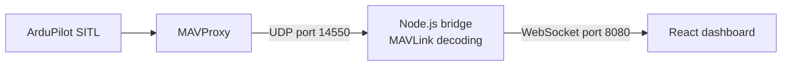

# Browser Ground Control Station (GCS)

A web-based Ground Control Station for monitoring an ArduPilot drone simulation, prepared for a technical trial submission to TraceX.

## Overview and Features

This project provides a real-time, browser-based dashboard to visualize telemetry data from an ArduPilot drone.

**Features:**
- Receives live MAVLink telemetry from an ArduPilot SITL (Software In The Loop) simulation.
- Decodes `GLOBAL_POSITION_INT`, `SYS_STATUS`, `HEARTBEAT`, and `ATTITUDE` messages.
- Broadcasts telemetry efficiently over WebSockets.
- Displays a professional, dark-themed React dashboard featuring:
  - Flight Mode and connection status.
  - Altitude (MSL) and Relative Altitude.
  - Ground Speed.
  - Battery Remaining (percentage and voltage).
  - Position (Latitude, Longitude).
  - Attitude (Roll, Pitch, Yaw).

## Technologies Used

- **Simulation**: ArduPilot SITL, MAVProxy
- **Backend (Bridge)**: Node.js, `mavlink-2`, `ws` (WebSocket)
- **Frontend (Dashboard)**: React 19, Vite 8, Zustand, Three.js, standard CSS

## Architecture



## Prerequisites and Setup (WSL2 Ubuntu Context)

*Note: These instructions assume you are running ArduPilot SITL in a WSL2 Ubuntu environment or similar Linux setup.*

1. **Node.js**: Use Node.js 22.12+ (Node 22 LTS recommended).
2. **ArduPilot SITL & MAVProxy**: Must be installed and configured in your WSL2/Linux environment.

## Startup Instructions

To run the full stack, you need to open four separate terminal windows/tabs. The SITL, MAVProxy, Node.js backend, and React frontend must all run simultaneously in their own terminals.

### 1. Start the ArduPilot Simulation
In a WSL2 Ubuntu terminal, navigate to your ArduPilot directory and start the SITL instance:
```bash
cd ~/ardupilot/ArduCopter
source ~/venv-ardupilot/bin/activate
../build/sitl/bin/arducopter --model + --speedup 1 --slave 0 --sim-address=127.0.0.1 -I0
```

### 2. Start MAVProxy and Forward Telemetry
In a **second** WSL2 Ubuntu terminal, activate the same Python virtual environment, connect to the running SITL instance, and add the UDP output for the backend:
```bash
source ~/venv-ardupilot/bin/activate
mavproxy.py --master=tcp:127.0.0.1:5760
```
Once the MAVProxy prompt appears, add the UDP output:
```text
output add 127.0.0.1:14550
```

### 3. Start the Backend Bridge
In a **third (WSL2 Ubuntu)** terminal, navigate to the project directory:
```bash
cd /mnt/c/Users/User/Documents/Backup/gcs-project

# Install backend dependencies (if not already done)
npm install

# Start the Node.js MAVLink bridge
npm start
```
*(Alternatively, from Windows PowerShell, you can run: `wsl --cd /mnt/c/Users/User/Documents/Backup/gcs-project npm start`)*

> [!IMPORTANT]
> Because ArduPilot SITL and MAVProxy send UDP packets to `127.0.0.1:14550` inside WSL2, the bridge **must** run inside WSL2 to receive those UDP packets. In WSL2 architecture, `127.0.0.1` is the VM's internal loopback; WSL2 does not forward UDP packets sent to `127.0.0.1` across the virtual machine boundary to Windows.

You should see:
```text
WebSocket server running on ws://localhost:8080
UDP bridge listening on 127.0.0.1:14550
Waiting for drone telemetry...
MAVLink receiver definitions loaded
MAVLink sender ready (System ID: 255, Component ID: 190)
```
*(Followed by periodic telemetry updates and packet diagnostic counters).*


### 4. Start the React Frontend
In a **fourth** terminal, navigate to the `client/` directory within this project:
```bash
cd client

# Install frontend dependencies (if not already done)
npm install

# Start the Vite development server
npm run dev
```
The application will be available at `http://localhost:5173`.

## Telemetry Fields and Data Flow

The `bridge.js` script decodes the following MAVLink messages into a JSON state object:
- **`GLOBAL_POSITION_INT`**: Latitude, Longitude, Altitude, Relative Altitude, Ground Speed.
- **`SYS_STATUS`**: Battery Voltage, Battery Remaining.
- **`HEARTBEAT`**: Flight Mode (e.g., STABILIZE, GUIDED, AUTO).
- **`ATTITUDE`**: Roll, Pitch, Yaw (converted from radians to degrees).

This state is broadcast to connected WebSocket clients every 2 seconds. The React dashboard subscribes to this data and updates its components accordingly. When no data is available, the UI gracefully displays `--`.

## Project structure and current functionality

- `bridge.js`: Node UDP MAVLink receiver on `127.0.0.1:14550`, WebSocket server on port `8080`, and outgoing mode/arm/disarm/takeoff commands with acknowledgements and timeouts. `UDP_HOST`, `UDP_PORT`, `WS_PORT`, `DRONE_COMMAND_HOST`, and `DRONE_COMMAND_PORT` configure the bridge. The frontend uses `VITE_WS_URL` when configured, or `ws://localhost:8080` during local development.
- `client/src/App.jsx`: React Router routes and WebSocket startup.
- `client/src/services/`: reconnecting WebSocket manager and telemetry freshness helpers.
- `client/src/store/slices/`: Zustand stores for telemetry, connections, commands, simulator display/demo state, saved flights, challenges, payloads and local plans.
- `client/src/components/layout/`: sidebar and dashboard shell.
- `client/src/components/views/`: functional route pages, local waypoint editor, recordings library, training, and diagnostics.
- `client/src/components/simulator/`: full-screen simulator, HUD, pause menu, flight controls, drone garage/models, and offline flight dynamics. `world/` contains the procedural Colombo environment, sky, GPS transforms, and optional Google tiles.
- `client/src/test/`: telemetry freshness, offline flight, sound, city geometry and page workflow tests.

All navigation destinations are implemented. Live telemetry and vehicle commands require the separately running bridge and SITL; the following browser workflows work offline:

| Page | Available workflow |
| --- | --- |
| Garage | Three interactive aircraft previews; selection is remembered across reloads. |
| Simulation | Launch offline flight, edit environment settings, inspect bridge health and retry the connection. SITL process startup remains manual. |
| Action | Observed-state flight commands, command history, and a locally saved waypoint plan with validation, JSON export and 3D preview. Mission upload is not supported by the bridge. |
| Environment | Timestamp-based route playback, scrubbing, speed controls, overview/top/follow cameras and route metrics. |
| Challenges | First flight, coastal circuit, City pursuit and Special delivery objectives measured during offline flight, with saved completion scores. Leaving after takeoff ends an unfinished challenge. |
| Gadgets | FPV field of view, camera tilt and simulated downward rangefinder. Building roofs are measured in the procedural world; rangefinding is unavailable in Google tile mode. |
| Multiplayer | Same-device, same-browser rooms between tabs using BroadcastChannel. Pilots share visible offline aircraft positions; no remote multiplayer server or peer collisions. |
| Recordings | Flights archive when recording stops or the simulator is left. Latest eight are stored locally; rename, import/export JSON, export CSV and replay. Plans keep their plan label. |
| Training | Three lessons with checked answers and remembered completion. |
| Views | Choose one of five simulator cameras, HUD and guide visibility, sound and volume. |
| Help | Connection/freshness diagnostics, offline keyboard controls and troubleshooting. |

Garage canvas dimensions are owned by CSS to prevent a resize feedback loop. Route changes release graphics resources, lazy loading reduces initial work, and an error boundary provides recovery if a page fails. Library, mission and lesson data are local to this browser; export important flights before clearing browser storage.

## Run the offline simulator

No backend, Python, ArduPilot, or API key is needed for offline flight. From the project root:

```bash
npm --prefix client ci
npm --prefix client run dev
```

Open the URL Vite prints (normally `http://localhost:5173`) and visit `/simulator`. Hold **W** to take off and **S** to descend and land. Use **A/D** to yaw left/right. **Q/E** are unassigned. The **Up** arrow flies forward and tilts the nose down; **Down** flies backward and tilts the nose up; **Left/Right** roll sideways. Release movement keys to hover. This is a simple kinematic training/demo model, not an ArduPilot physics simulation. Diagonal movement is limited to 20 m/s; climb/descent is 8 m/s.

Use **1–5** or **C** for chase/FPV/top/side/free cameras, **Esc** to pause, **H** for the HUD, **G** for the guide, and **F** for the live command drawer. Losing window focus pauses and clears keyboard input. Pausing the view does not pause external SITL. Keyboard movement controls offline flight only; live commands use the command drawer.

The HUD explicitly labels demo mode and shows simulated relative altitude, speed, heading, roll, and pitch. MSL altitude and battery remain unavailable in demo mode. Demo state stays separate from live telemetry. Fresh, finite GPS with a connected WebSocket switches the view to live position; missing/stale GPS falls back to demo. Because the current bridge rebroadcasts cached state, frontend freshness measures receipt age, not the age of each MAVLink sensor sample.

Google photorealistic tiles are optional: configure `VITE_GOOGLE_MAPS_API_KEY` in `client/.env.local` and press **B**. Without a key, the procedural environment remains available. The Google service requires network access and an appropriately configured key. Browser WebGL support is required for 3D rendering.

## Coastal environment and graphics

The simulator's existing Three.js renderer now includes a detailed, Colombo-inspired coastal district: windowed facades with nighttime occupancy lighting, roof equipment, sidewalks, lane markings, crossings, palms, leafy trees, benches, harbour cranes, and illuminated landing pads. The district is an illustrative environment, not a survey-accurate map. All scenery, materials, and aircraft are generated locally; no asset downloads or API keys are required.

Open **Environment** in the simulator HUD or press **I**. Choose **Dawn**, **Day**, **Golden**, or **Night**, scrub the time slider, adjust coastal haze, or enable the continuous day/night cycle (2, 8, 20, or 60 real minutes per simulated day). Sunlight, moving clouds, moonlight, stars, ocean reflections, windows, lamps, and vehicle lights follow the selected time. The clock and city motion freeze with the pause menu. These visual settings do not change external SITL conditions.

Traffic follows two opposing closed street routes; animated pedestrians walk along the waterfront and avenue sidewalks. **Traffic & pedestrians** toggles this decorative activity. Building collision protection uses explicit building bounds, separate from merged scenery. Moving cars collide with the offline drone. A collision triggers a fragment explosion, stops flight input and presents a restart action. Pedestrians remain visual actors.

- **Low:** standard pixel density, fewer people and vehicles, no shadow map.
- **Balanced** (default): capped 1.5× pixel density, 1024px sun shadows, full city activity.
- **High:** up to 2× pixel density, 2048px sun shadows, subtle bloom.

The garage's three existing aircraft now have shaped housings, connected arms, detailed motors, carbon components, camera lenses, landing gear, and navigation lights. Drag or scroll the garage preview to inspect them. Rotor motion is frame-rate independent and stops when the drone is grounded and disarmed. All aircraft retain the existing offline flight model; their displayed specifications do not change the flight dynamics.

Optional Google tiles retain the procedural fallback while loading or after a root-load error. Procedural city activity is hidden when tiles are ready; the handcrafted building collision bounds are also disabled in tile mode. Buildings in Google tiles do not currently have collision protection. The original cameras, flight controls, telemetry, recording, route replay, command drawer, and tile attribution remain available.

Street intersections use segmented road and sidewalk surfaces that meet at their edges, eliminating the near-coplanar overlap that caused flickering as the camera moved over the road grid.

The renderer uses logarithmic depth so thin ground, pavement, road and marking layers remain separated in aerial views. The custom ocean and sky shaders support the same depth convention.

### Arcade challenges

Open **Challenges** to start **City pursuit** or **Special delivery**. Challenges use the procedural city and offline controls; tiles are disabled during an active mission.

- **City pursuit:** climb above 3 m and chase the orange car. Get within 35 m horizontally at 3–40 m altitude; tap **T** or use the HUD action to detonate the locked target. Holding **T** for 0.5 seconds detonates the drone after an escalating warning beep. Fire, expanding shock rings, smoke and debris accompany the explosion. Cars within 13 m stop and become wrecks. Catch the target within three minutes.
- **Special delivery:** wait one second on pad A to load a parcel. Fly to the green B marker, land within its ring and remain still. The recipient walks to the drone, reaches for the parcel and carries it back. Taking off before collection resets the approach.
- Traffic collisions destroy the offline aircraft, show tumbling fragments and a crash sound, and fail an active challenge. Use **Retry challenge** or **Restart flight** to recover. Explosions and flight movement stop while paused; sound follows the shared mute and volume settings.

**T** is reserved for the pursuit action. The optional Google tiles shortcut is now **B**. Camera changes snap to the new view, keep top/free orientation independent and remain available while flight is paused.

### Flight sound

Sound starts after your first flight key or click. Each aircraft has a layered rotor sound that responds to climb and speed, with prop wash, wind, coastal surf, distant traffic, occasional daytime birds and proximity alerts. Camera distance attenuates the motors; altitude fades the city and shoreline. All sound is synthesized locally without audio downloads.

Use **M** or the HUD sound button to mute. Volume is available under **Environment (I)** and in the pause menu; mute and volume are remembered locally. Pausing, switching away from the page or leaving the simulator silences playback. These are simulator sounds, not audio from a connected vehicle.

## Run with ArduPilot SITL

Follow the four-terminal WSL2 steps above. Install root dependencies using `npm ci` and frontend dependencies using `npm --prefix client ci`. Start the bridge with `npm start`, then the frontend with `npm --prefix client run dev`. The bridge must share the UDP network environment with MAVProxy. Its mode and command handlers provide bidirectional control; the original read-only limitation no longer applies.

## Checks

From the project root:

```bash
node --check bridge.js
npm --prefix client test
npm --prefix client run lint
npm --prefix client run build
```

The root `npm test` script is still an unconfigured placeholder. The client tests cover telemetry freshness, offline flight invariants, sound lifecycle, street geometry, recording validation and persistence, timed replay, mission validation, challenge progression, training answers, payload controls and local peer discovery. Build output is written to `client/dist`; `npm --prefix client run preview` serves it locally. Full MAVLink command acceptance requires a running SITL instance.

## Web hosting

Sites project: `appgprj_6af2e8507d3881918051e0b70027f2dd`. The hosting manifest is saved in `.openai/hosting.json`; the isolated frontend publishing checkout and deployment archive are under ignored `.sites-deploy/`. This keeps publishing commits separate from the original working tree.

The hosted frontend defaults to offline simulation. To connect a remote bridge, set `VITE_WS_URL=wss://your-bridge.example.com` before rebuilding. The UDP/MAVLink bridge and SITL must run on a separate server; they are not included in static hosting. The bridge needs secure WebSocket termination for an HTTPS frontend. Local development still defaults to `ws://localhost:8080`.
